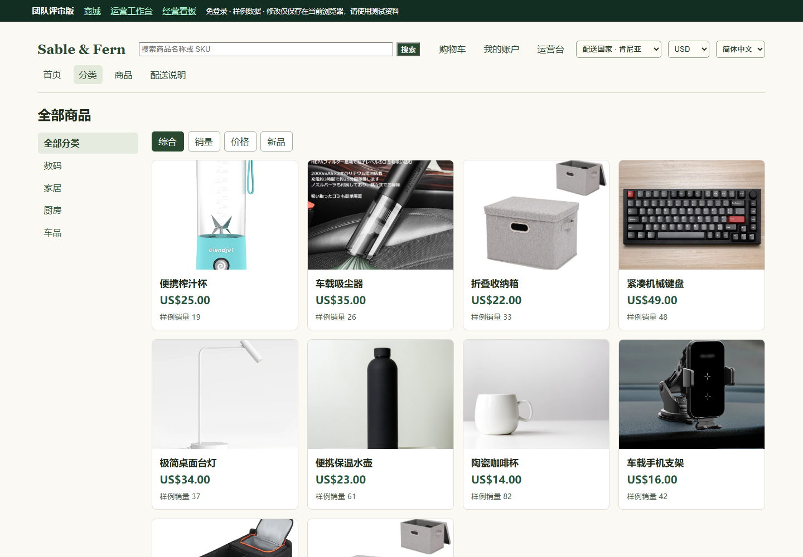
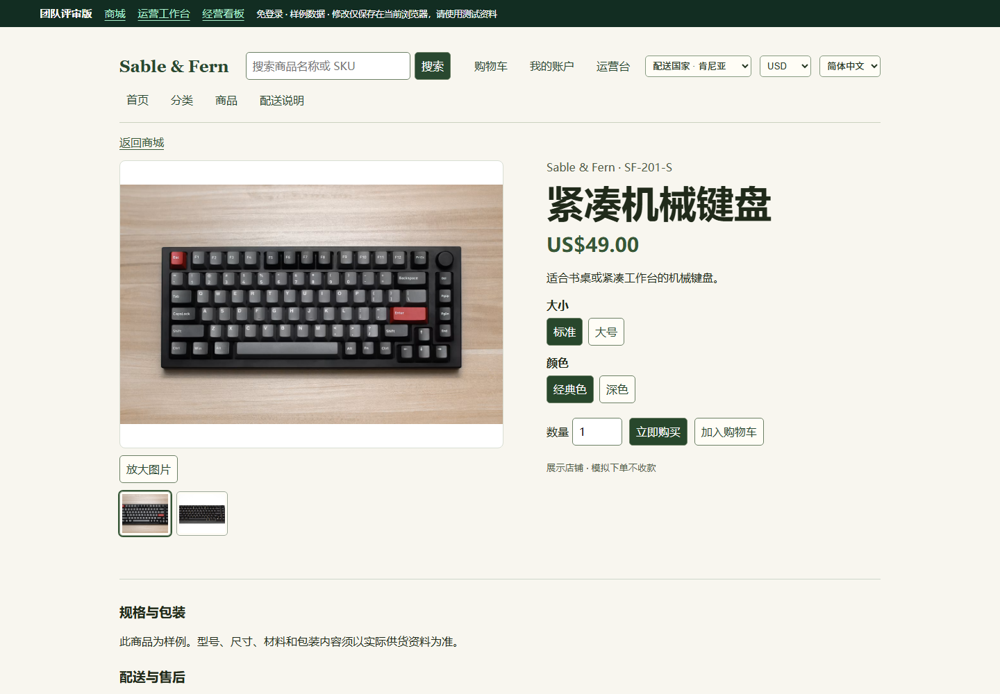
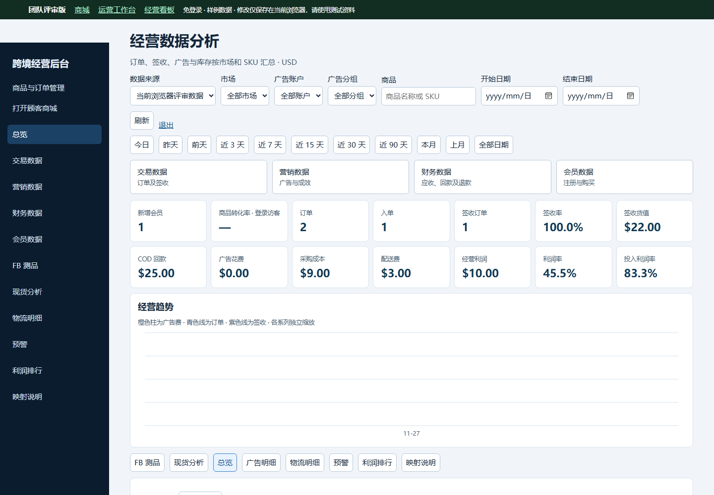

# 🌿 Sable & Fern

**跨境电商独立站 · 顾客商城 / 运营工作台 / 经营看板**

[**网站示例**](https://sable-fern-team-review.pages.dev/) · [页面展示](#screenshots) · [部署说明](#deployment)

## 📖 项目简介

Sable & Fern 是一个跨境电商独立站 Demo，用于验证从商品上架、按收货国家选购，到模拟货到付款、后台履约和经营分析的完整流程。

| 模块 | 主要能力 |
|---|---|
| 🛍️ 顾客商城 | 按配送国家展示商品，支持分类、搜索和排序，以及商品多图、规格选择、购物车和模拟结账 |
| 📦 运营工作台 | 商品编辑和上下架，设置可售国家、规格与库存，处理模拟订单、发货和签收 |
| 📊 经营看板 | 按市场、日期和 SKU 查看交易、广告、物流、库存及 COD 回款，支持导出经营明细 |

网站示例使用样例数据，可直接浏览商城并体验工作台。操作仅保存在当前浏览器，请使用虚构收货资料。支付、物流和退款均为演示流程。

## 🖼️ 页面展示

以下为网站示例的实际运行截图。

### 🛍️ 商品分类

### 🔎 商品详情

### 📈 经营看板

## 🚀 源码与部署

| 分支 | 内容 |
|---|---|
| [main](https://github.com/miaomiao0227/sable-fern-demo/tree/main) | 商城与运营系统源码，含 Cloudflare Worker 构建、数据库迁移与登录配置 |
| [pages-review](https://github.com/miaomiao0227/sable-fern-demo/tree/pages-review) | Cloudflare Pages 网站示例源码 |

[Cloudflare Workers 部署](cloudflare/WORKERS.md) · [Cloudflare Pages 示例部署](https://github.com/miaomiao0227/sable-fern-demo/blob/pages-review/cloudflare/REVIEW-PAGES.md)
